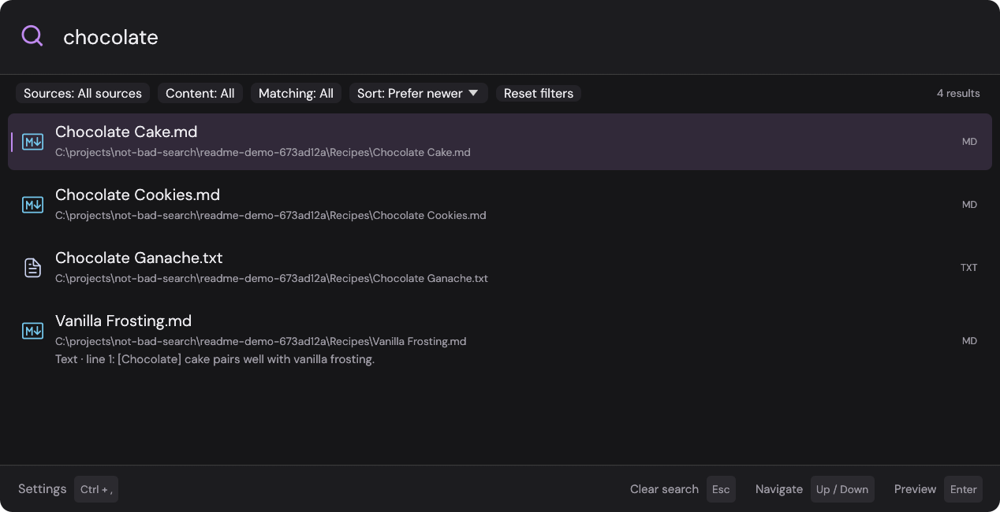

# Not Bad Search

A Windows 11 search launcher with keyword and semantic search across a local index.

- **Files:** filenames and the contents of Markdown and plain-text files.
- **Images:** extracted text and descriptions with opt-in image indexing.
- **Connected sources:** Jira issues, Slack threads, Gmail conversations, and Notion pages.

**Speed:** Under 7 ms at the 95th percentile for each of six warm filename queries on a synthetic index of 100,000 files. This measures database query time.

Add sources in **Settings**, then press **Ctrl+Alt+Space** to open search.

